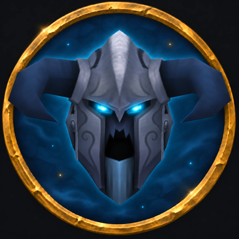
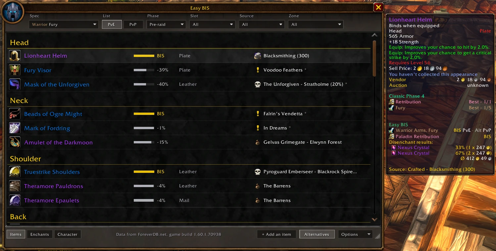
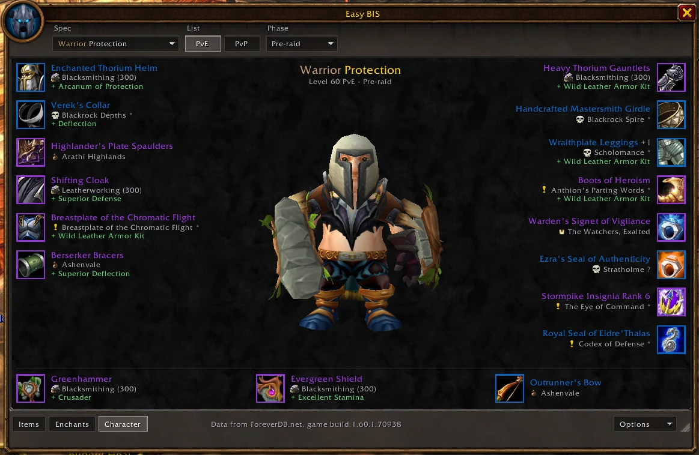

# Easy BIS

Best-in-slot gear for every class and spec of **WoW Forever**, in a window and in item tooltips.

- **Items**: the best items of each slot at level 60, PvE and PvP, with their alternatives and sources. You can filter by phase, slot, source and zone, and add items to a list yourself.
- **Character**: the BIS #1 of each slot laid out as a character sheet, with its best enchant, worn by your own character.
- **Enchants**: the best enchant of each slot and how to get it.
- **Tooltips**: which classes and specs want an item, and whether it is their BIS.

Type `/easybis` (or `/ebis`) in the game, or `/easybis help` for the commands.





## Install

Put the `EasyBIS` folder in `World of Warcraft\_forever_\Interface\AddOns`, then restart the game.

## For developers

The addon's data (`Data/*.lua`) is generated from ForeverDB's addon data by the Python tool in `_build`:

```
python -I _build/build.py            # rebuild Data/*.lua from the cached ForeverDB files
python -I _build/build.py --check    # is newer ForeverDB data out?
python -I _build/build.py --update   # download what changed (SHA-256 checked) and rebuild
python -I _build/build.py --import-questie   # read in the QuestieDB addon the sources ForeverDB's data lacks
```

Offline tests (they need `lupa`, and `Pillow` for the textures):

```
python -P _build/tests/test_generator.py
python -P _build/tests/test_addon.py
python -P _build/tests/test_ui.py
```

`_build/art/make_textures.py` makes `Media/*.tga` from a logo. The release zip leaves out `_build` and `docs` (`.pkgmeta`).

## Licence and credits

**Data from [ForeverDB.net](https://foreverdb.net).** The sources ForeverDB's data lacks come from [QuestieDB](https://github.com/Questie/QuestieDB). Easy BIS is free software under the GNU GPL, version 3 (`LICENSE.txt`). `NOTICE.txt` says where each part comes from and what reusing it requires.

Easy BIS is not affiliated with Blizzard Entertainment, ForeverDB.net or the Questie team.
