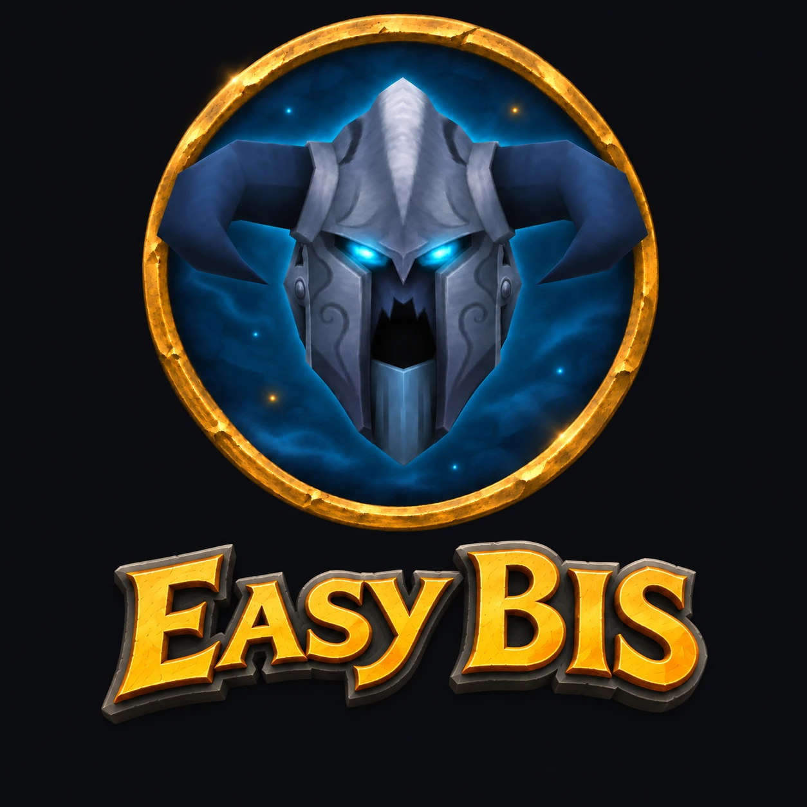
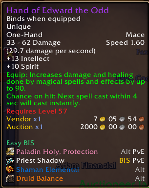

**The best gear for every class and spec of WoW Forever, in one window and in your item tooltips.**

Easy BIS is a BIS list for every class and spec: the best-in-slot (BIS) item of every slot at level 60, for PvE and PvP, with the alternatives behind it and where each piece comes from. Plan your pre-BIS gear before the raids, follow your full BIS gear set as new phases open, and keep track of what to farm next. It knows the enchants too, and it lays your spec's best set out as a character sheet.

The lists come from [ForeverDB.net](https://foreverdb.net), built for WoW Forever, so they include items that are new in Forever.

## The window

Type `/easybis` (or `/ebis`), or click the minimap button.

**Items** lists the best items slot by slot, with the alternatives under each one.

- The bar shows how close each alternative comes to the BIS.
- The source is shown for every item: dungeon boss and drop chance, quest, crafting profession and skill, vendor, reputation or world drop.
- You can filter by spec, PvE or PvP list, content phase, slot, source and zone.
- Hover an item to see its tooltip and its full source. Shift-click an item to link it in chat.
- Missing an item you like? Use **+ Add an item** to put it in a list yourself.

**Character** shows the BIS #1 of every slot as a character sheet. Each slot comes with its best enchant, and your own character wears the whole set. Click a slot to see all its picks.

**Enchants** gives the best enchant of every slot, its effect and how to get it.

## In your tooltips

Every item tooltip says which classes and specs want that item, and whether it is their BIS or an alternative, in PvE or in PvP.

## Content phases

The lists follow the game's progress. **Pre-raid** (the default) only counts gear you can get today. **Phase 1** adds Forever's first raids, and **Everything** shows the lists without any limit. Choose the phase in the window or with `/easybis phase`.

## Commands

| Command | What it does |
|---|---|
| `/easybis` | open or close the window |
| `/easybis item [link or ID]` | say who wants an item |
| `/easybis list [1-3] [pvp]` | print the list of one of your specs in chat |
| `/easybis phase [0, 1 or all]` | choose where the lists stop |
| `/easybis add [link or ID] [off]` | add an item to the list the window shows |
| `/easybis remove [link or ID]` | take a hand-added item out again |
| `/easybis tooltip`, `class`, `alt` | tooltip lines on or off, your class only, alternatives |
| `/easybis unsourced`, `seen` | items with no known source, items seen in Forever only |
| `/easybis minimap` | show or hide the minimap button |
| `/easybis help` | list the commands |

More settings are in the window's **Options** menu.

## Languages

English and French. The addon follows the game's language. Item, spell and zone names come from the game. Quest, boss and vendor names stay in English.

## Good to know

- Easy BIS is made for **WoW Forever** (level 60).
- Sources marked with `*` come from Classic's data and have not been confirmed in Forever yet.

## Credits and licence

**Data from [ForeverDB.net](https://foreverdb.net).** Thanks to ForeverDB for sharing its data under an open licence.

Easy BIS is free software under the GPL-3.0. Source code, bug reports and suggestions: [github.com/jBeyondstars/EasyBIS](https://github.com/jBeyondstars/EasyBIS).

Easy BIS is not affiliated with Blizzard Entertainment or ForeverDB.net.
