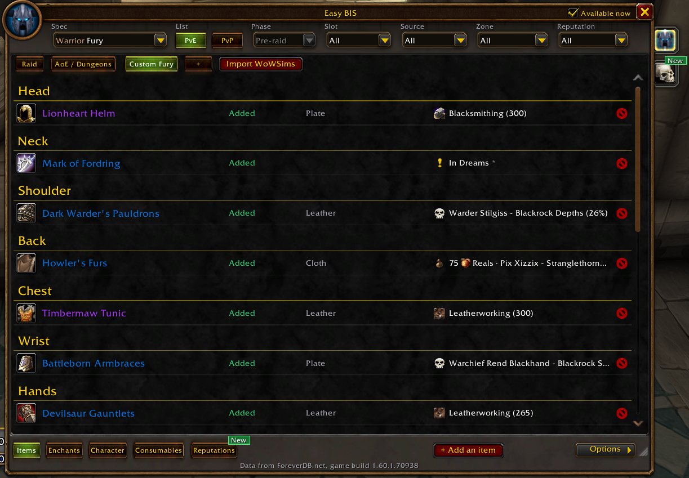
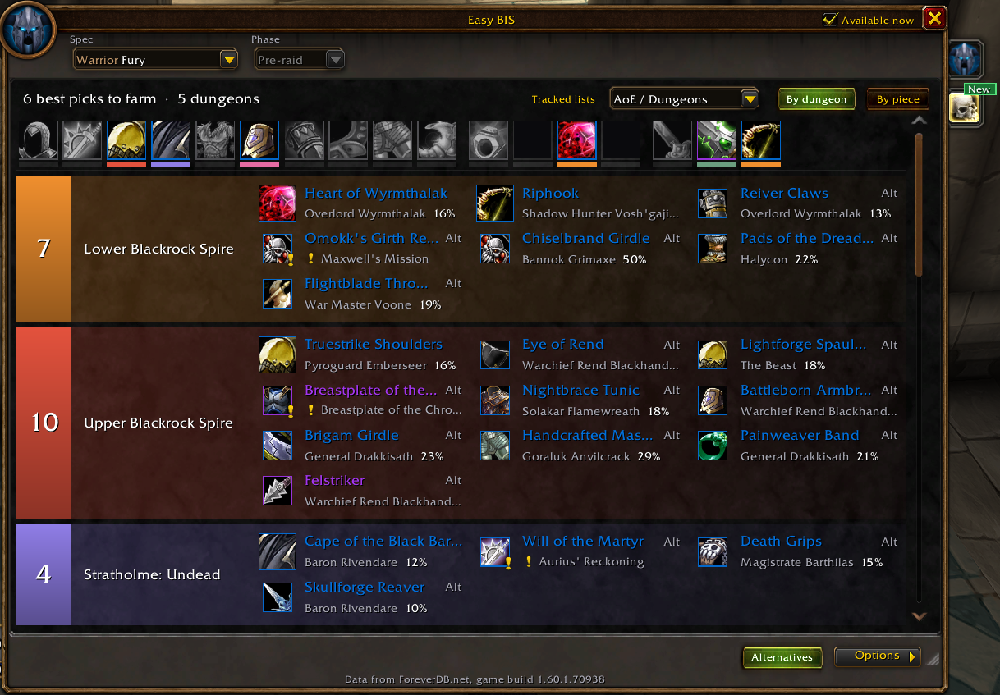
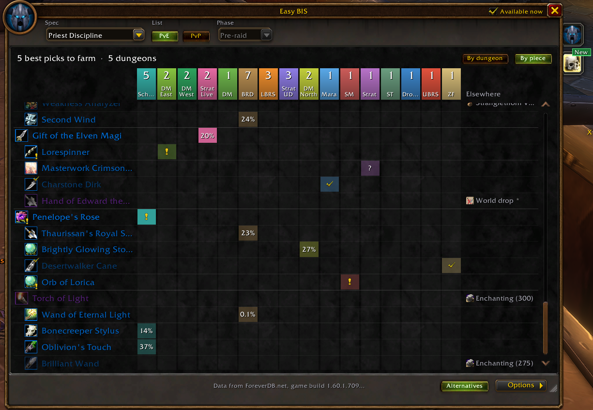
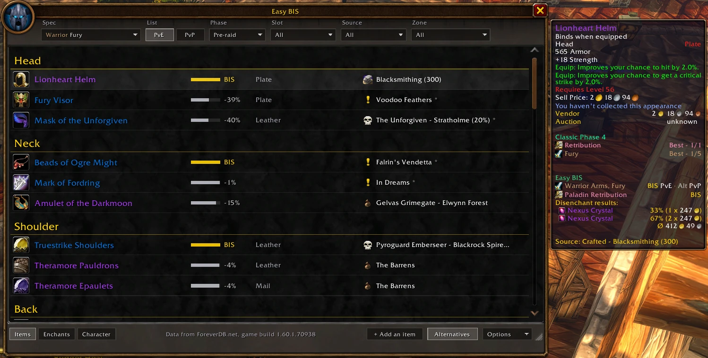
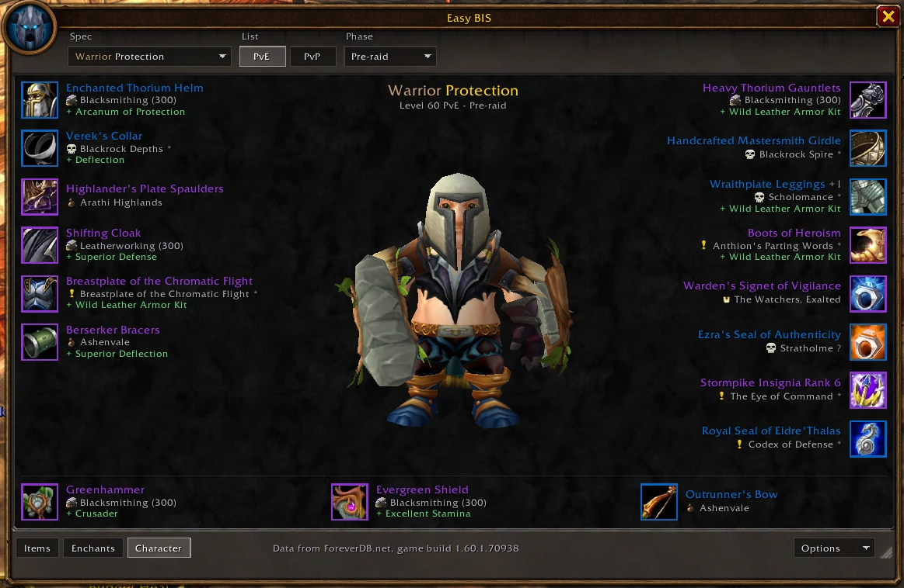
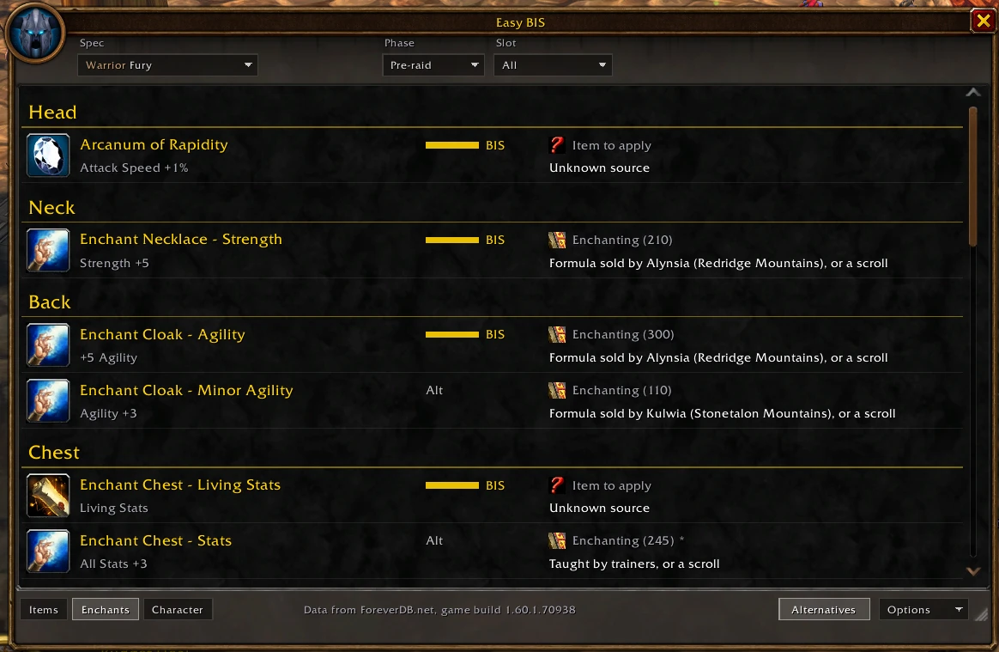
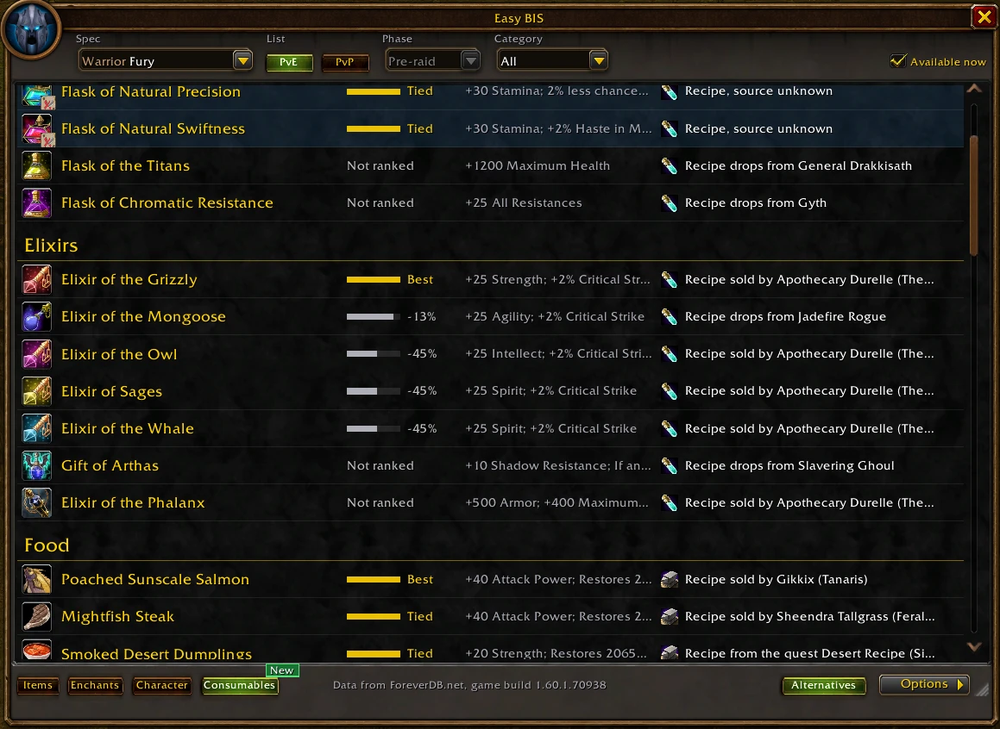
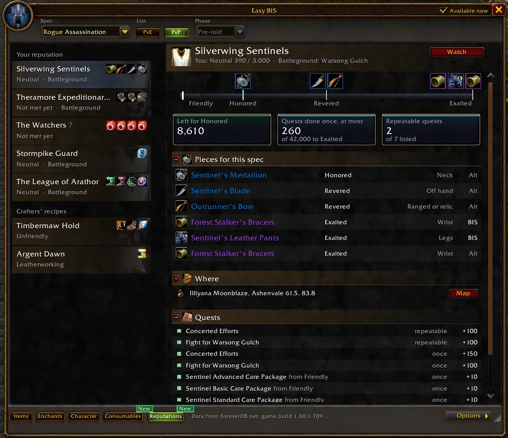
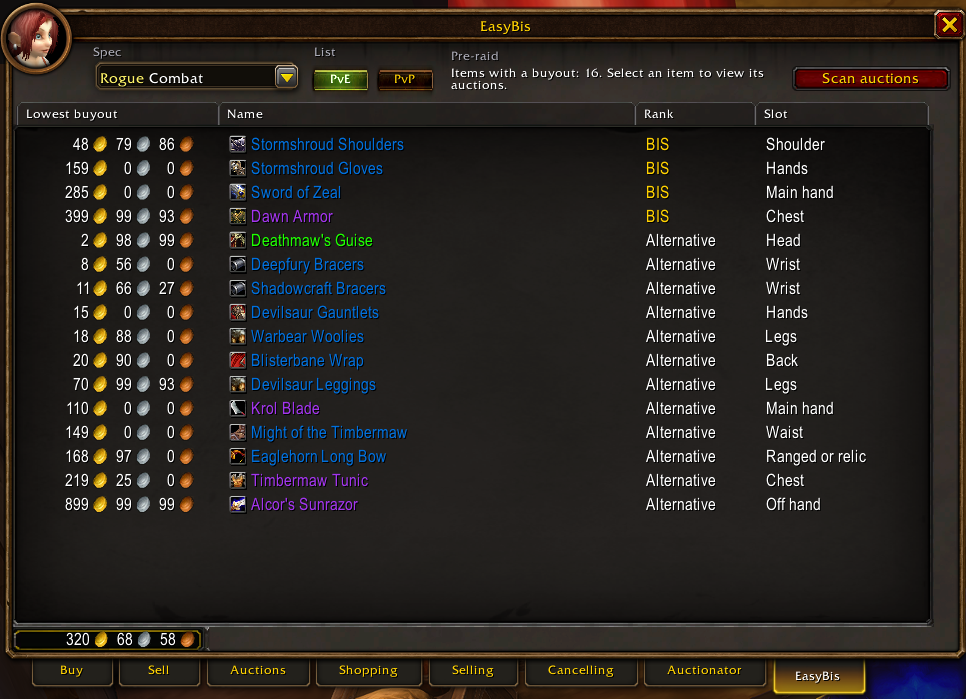

## (New!) Custom list and import WoWSims Forever

Build a gear list for your class and specialization under **Items → PvE**. Click **+**, name your list, then use **Add an item** to fill it one slot at a time.

Already have a set in WoWSims Forever? In the simulator's export options, select **Gear** only and copy the JSON. Open the custom list you want to update, click **Import WoWSims** and paste the export. Importing replaces that list's items and enchants. Drag its tab to reorder it, or right-click to rename, move or delete it.

## About Easy BIS

**The best gear for every class and spec of WoW Forever, in one window and in your item tooltips.**

Easy BIS is a BIS list for every class and spec: the best-in-slot (BIS) item of every slot at level 60, for PvE and PvP, with the alternatives behind it and where each piece comes from. Plan your pre-BIS gear before the raids, follow your full BIS gear set as new phases open, and keep track of what to farm next. It knows the enchants, the consumables and the reputations too, it lays your spec's best set out as a character sheet, it shows which dungeons to run for it, and it finds the pieces of your list that are on sale at the auction house.

## Dungeons

The **Dungeons** tab shows which dungeons to run for your spec's best picks, each dungeon in its own colour. It is the second tab on the window's right side.

- Open **Tracked lists** to combine Raid, PvP, AoE / Dungeons and your custom lists. Easy BIS remembers the selection for your character and specialization.
- **By dungeon** shows your set, every slot over the colour of its dungeon, then a band per dungeon with the pieces it holds, each with its boss and its drop chance. A piece no dungeon holds is in black and white.
- **By piece** shows a line per piece and a column per dungeon, with a coloured cell where the piece drops.
- A wing that is run on its own counts as a dungeon: Upper and Lower Blackrock Spire, the wings of Dire Maul, Stratholme and the Scarlet Monastery.
- A quest's reward sits with the dungeon its quest is done in, under the quest mark.
- What you already have, worn, in your bags or in the bank, is checked. The **Alternatives** button adds the alternatives of every slot.
- Point at a dungeon to light its slots. Click a piece to see its slot in the Items tab.

## AoE / Dungeons gear

Under **Items → PvE**, 21 damage profiles have a dedicated **AoE / Dungeons** list for each faction. Rankings combine a four-enemy pull with a multi-pull dungeon run. Hover over a weapon to see its recommended partner and how the pair performed in both scenarios. Survival Hunters use the ranged profile for dungeons.

## The window

Type `/easybis` (or `/ebis`), or click the minimap button.

The window has two tabs on its right side: the lists, with their own tabs at the bottom, and the dungeons.

**Items** lists the best items slot by slot, with the alternatives under each one.

- The bar shows how close each alternative comes to the BIS.
- The PvE lists of the damage specs are ranked by simulation, which counts the items with an effect (Hand of Justice...).
- The source is shown for every item: dungeon boss and drop chance, quest, crafting profession and skill, vendor, reputation or world drop.
- You can filter by spec, PvE or PvP list, content phase, slot, source, zone and reputation.
- Hover an item to see its tooltip and its full source. Shift-click an item to link it in chat.
- Missing an item you like? Use **+ Add an item** to put it in a list yourself.

**Character** shows the BIS #1 of every slot as a character sheet. Each slot comes with its best enchant, and your own character wears the whole set. Click a slot to see all its picks.

**Enchants** gives the best enchant of every slot, its effect and how to get it.

**Consumables** ranks flasks, elixirs, food, scrolls, weapon stones and oils and combat potions on your spec's stat weights, and healing potions, mana potions and bandages on the amount they restore, for PvE and PvP.

- Each category is ranked on its own: the tab does not tell you which ones stack.
- What each consumable does is read from its tooltip in the game.
- Flasks of maximum health or mana, and protection and utility potions, are listed without a rank.
- A bonus that only works in some zones or against some creatures does not count in the ranking, and is shown next to the item.

**Reputations** shows what your spec needs of each faction, and where you stand with it.

- Each faction's pieces sit on a track from Neutral to Exalted, above the standing that unlocks them.
- How much reputation is left to earn, where the pieces come from (click a vendor to see it on the map), and the quests your class can take, the repeatable ones first.
- A battleground's faction says so, and names its battleground. The Alterac Valley and Warsong Gulch quartermasters' pieces say which standing they need on your side, though their tooltips don't.
- What no source says is written as unknown: the reputation creatures give, or how to go the whole way to Exalted.
- A faction that sells recipes, such as Timbermaw Hold's patterns, counts for the crafter: the tab names the recipes and their vendors, and follows your professions.
- Click a faction to follow it in the game's reputation bar.
- Items, Enchants and the Character sheet say which reputation a piece asks for and where you stand.

## At the auction house

The **EasyBis** tab of the auction house shows which pieces of your list are on sale, each with its lowest buyout.

- Pick a class, a spec and the PvE or PvP list, then click **Scan auctions**. The choice is the window's own: changing one changes the other.
- The results read like the game's own list: price, item, BIS or alternative, and slot. The best picks come first, then the cheapest.
- Click an item to open its auctions.
- The scan asks for each piece of your list and shows how far along it is. Pieces that bind when picked up are left out, and neither bids without a buyout nor your own auctions count as a price.
- The tab comes after the other addons' tabs, Auctionator's included. **Options > Auction house tab** takes it away.

## In your tooltips

Every item tooltip says which classes and specs want that item, and whether it is their BIS or an alternative, in PvE or in PvP. An item sold against a reputation also shows the standing it asks for and where you stand.

## Content phases

The lists follow the game's progress. **Pre-raid** (the default) only counts gear you can get today. **Phase 1** adds Forever's first raids, and **Everything** shows the lists without any limit. Choose the phase in the window or with `/easybis phase`.

## Commands

| Command | What it does |
|---|---|
| `/easybis` | open or close the window |
| `/easybis item [link or ID]` | say who wants an item |
| `/easybis list [number] [pvp]` | print the list of one of your specs in chat |
| `/easybis phase [0, 1 or all]` | choose where the lists stop |
| `/easybis add [link or ID] [off]` | add an item to the list the window shows |
| `/easybis remove [link or ID]` | take a hand-added item out again |
| `/easybis tooltip`, `class`, `alt` | tooltip lines on or off, your class only, alternatives |
| `/easybis unsourced`, `seen` | items with no known source, items seen in Forever only |
| `/easybis pvp [pve or pvp]` | count the PvP rewards (PvP ranks, honor, battlegrounds) in that list, or leave them out |
| `/easybis alternatives [2-6]` | how many alternatives a slot lists |
| `/easybis faction [alliance, horde or auto]` | show the lists of the other faction, or your own again |
| `/easybis minimap` | show or hide the minimap button |
| `/easybis help` | list the commands |

More settings are in the window's **Options** menu.

## Languages

English and French. The addon follows the game's language. Item, spell and zone names come from the game. Quest, boss and vendor names stay in English.

## Good to know

- Easy BIS is made for **WoW Forever** (level 60).
- Sources marked with `*` come from Classic's data and have not been confirmed in Forever yet.
- The lists follow your character's faction: an item of the other faction is replaced by its counterpart. **Options > Faction** shows the other faction's lists.

## Credits and licence

**Data from [ForeverDB.net](https://foreverdb.net).** Thanks to ForeverDB for sharing its data under an open licence.

Quests, and where some items come from, are read in [QuestieDB](https://github.com/Questie/QuestieDB) and [Questie](https://github.com/Questie/Questie) (GPL-3.0).

The standing the Alterac Valley and Warsong Gulch quartermasters ask for is read in the tables of AtlasLoot Forever (GPL-2.0), and checked against ForeverDB's data.

The PvE lists of the damage specs are ranked with [WoWSims Forever](https://github.com/wowsims/forever), the WoWSims team's simulator.

Easy BIS is free software under the GPL-3.0. Source code, bug reports and suggestions: [github.com/jBeyondstars/EasyBIS](https://github.com/jBeyondstars/EasyBIS).

Easy BIS is not affiliated with Blizzard Entertainment, ForeverDB.net, the Questie team, the WoWSims team or the AtlasLoot authors.
